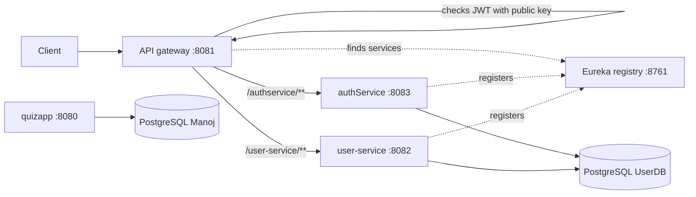

# Spring Boot Microservices

This repo holds my microservice practice work. There are two parts: `quizapp`, a single Spring Boot app with JWT login and a quiz API, and `projectPractice`, where I split a user system into separate services behind a gateway with Eureka for discovery.

## Features

- Register and login with BCrypt passwords, short-lived JWT access tokens and a refresh token stored in the database (sent as a cookie).
- Quiz API: add questions with categories and answers, fetch random questions for a category, submit answers and get a score.
- Spring Cloud Gateway that routes by service name and checks the JWT before passing requests on.
- Eureka server so services find each other by name.
- Profile image upload on registration (saved to a local folder).

## Tech stack

Java 17, Spring Boot, Spring Security, Spring Data JPA, Spring Cloud (Eureka, Gateway MVC, OpenFeign dependency), PostgreSQL, JJWT, Lombok, Maven.

## Services

| Folder | Port | What it does |
|---|---|---|
| `projectPractice/service-registry` | 8761 | Eureka server |
| `projectPractice/apiGateway` | 8081 | Routes `/authservice/**` and `/user-service/**`, validates the JWT |
| `projectPractice/user-service` | 8082 | Profile update endpoint |
| `projectPractice/authService` | 8083 | Register, login, refresh; signs tokens with an RSA private key |
| `quizapp` | 8080 (default) | Standalone quiz app with its own login, uses an HMAC secret |

The gateway talks to the other services through Eureka (`lb://` routes). The services use the public key to check tokens. I did not find any service calling another over REST or Feign in the code, and there is no Kafka.

## Architecture



authService signs tokens with an RSA private key. The gateway and the other services only hold the public key.

## Running it locally

Needs JDK 17 and PostgreSQL. Each service has its own Maven wrapper.

1. Create the databases `UserDB` (the three services share it) and `Manoj` (quizapp).
2. In each service's `application.properties`, set your own `spring.datasource.password` (`your_password`) and JWT values. authService needs an RSA key pair (`jwt.private-key`, `jwt.public-key`, base64 encoded); the gateway and user-service need the matching public key. quizapp needs `jwt.secret`.
3. Start the registry first, then the rest:

```
cd projectPractice/service-registry && ./mvnw spring-boot:run
cd projectPractice/authService && ./mvnw spring-boot:run
cd projectPractice/user-service && ./mvnw spring-boot:run
cd projectPractice/apiGateway && ./mvnw spring-boot:run
```

Tables are created by Hibernate (`ddl-auto=update`).

## Endpoints

Through the gateway (port 8081):

- `POST /authservice/api/v1/user/register` register (form fields email, password, userName, optional profilePic)
- `POST /authservice/api/v1/user/login` login
- `GET /authservice/api/v1/user/refresh` get a new access token using the refresh cookie
- `POST /user-service/api/v1/user/updateUser` update user details (needs a token)

quizapp:

- `POST /api/v1/user/register`, `POST /api/v1/user/login`, `GET /api/v1/user/refresh`
- `POST /api/v1/quiz`, `GET /api/v1/quiz`, `GET /api/v1/quiz/{category}` manage questions
- `GET /api/v1/quizs?category=&count=` get a quiz, `POST /api/v1/quizs/submit` score it

## Notes

This is practice code. There are no real tests beyond the generated context tests, and the same security and utility classes are copied between services instead of shared.
